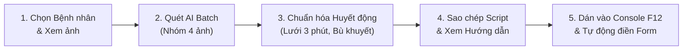

# 🫀 MONITOR OCR & AUTO-FILL v2.0 Pro
### Hệ thống Trích xuất Huyết động Monitor & Tự động Nhập liệu Bệnh án Can thiệp Mạch Não (EVT)

[](https://github.com/nguyentranminhchien-ccpl/monitor-ocr-autofill)
[](https://www.python.org/)
[](LICENSE)
[](mailto:nguyentranminhchien.hpmu@gmail.com)

> **Tác giả:** BS. Nguyễn Trần Minh Chiến  
> **Email:** [nguyentranminhchien.hpmu@gmail.com](mailto:nguyentranminhchien.hpmu@gmail.com)  
> **Lĩnh vực:** Đột quỵ não & Hồi sức Tích cực.

---

## 🌟 Giới thiệu

**Monitor OCR & Auto-fill** là bộ công cụ thông minh giải quyết triệt để khâu nhập liệu huyết động tốn nhiều thời gian và dễ nhầm lẫn trong các nghiên cứu lâm sàng can thiệp đột quỵ não:
1. **Trích xuất bằng Thị giác AI (Gemini Vision)**: Đọc chính xác toàn bộ bảng *"Vital Signs"* (Huyết áp tâm thu SBP, tâm trương DBP, trung bình MAP, Nhịp tim HR, SpO2, etCO2) từ ảnh chụp màn hình monitor (Philips IntelliVue MX550/MP70, GE Carescape, Mindray...).
2. **Chuẩn hóa chuỗi thời gian 3 phút/lần**: Tự động ghép nối chuỗi ảnh theo thứ tự thời gian, tự động định dạng giờ 24h chuẩn `HH:MM`, rà soát từng phút đo ngắt quãng và xử lý dữ liệu khuyết thiếu (*Forward-fill* hoặc *Nội suy tuyến tính*).
3. **Tự động điền biểu mẫu (Auto-fill)**: Sinh mã JavaScript chạy trực tiếp trên Console trình duyệt (F12) sử dụng cơ chế `nativeInputValueSetter`, tự động lấp đầy toàn bộ bảng theo dõi trong 1 giây.


*Giao diện làm việc trực quan: Xem trước ảnh monitor bên trái và bảng số liệu chuẩn hóa lưới 3 phút bên phải.*

---

## 📥 Hướng dẫn Cài đặt (Chọn 1 trong 2 cách)

---

### CÁCH 1: Cài đặt qua Antigravity App (Dành cho Bác sĩ không cần biết lập trình)

Nếu bạn đang sử dụng ứng dụng trợ lý AI Antigravity, việc cài đặt và sử dụng plugin vô cùng đơn giản:

#### 🔹 Cách A: Cài đặt bằng 1 câu chat (Nhanh nhất)
1. Mở ứng dụng **Antigravity**.
2. Trong ô nhập tin nhắn chat, bạn chỉ cần gõ hoặc dán câu sau rồi nhấn **Enter**:
   > *"Cài đặt plugin từ https://github.com/nguyentranminhchien-ccpl/monitor-ocr-autofill"*
   
   *(hoặc gõ lệnh: `/plugin install https://github.com/nguyentranminhchien-ccpl/monitor-ocr-autofill`)*
3. Antigravity sẽ tự động tải về, cài đặt và thông báo plugin đã sẵn sàng hoạt động!

#### 🔹 Cách B: Cài đặt qua menu Giao diện (GUI)
1. Trong Antigravity, nhấp vào biểu tượng **Cài đặt (Bánh răng ⚙️)** ở góc dưới bên trái.
2. Chọn mục **Plugins**.
3. Nhấp vào nút **Add Plugin** (hoặc *Install Plugin*).
4. Dán link GitHub: `https://github.com/nguyentranminhchien-ccpl/monitor-ocr-autofill` rồi nhấn **Install**.

#### 🎯 Cách sử dụng trực tiếp trong Antigravity Chat:
* Kéo và thả toàn bộ ảnh chụp monitor vào ô chat.
* Nhắn một câu ngắn gọn:  
  > *"Nhận diện ảnh monitor này và tạo script auto-fill cho form EVT giúp tôi."*
* Antigravity sẽ tự động đọc bảng chỉ số, hỏi bạn mốc thời gian bắt đầu/kết thúc ($T_0, T_{end}$) và xuất bảng số liệu kèm mã script tự động.

---

### CÁCH 2: Tải Bản Web App Độc lập từ GitHub Releases (Không cần cài Antigravity)

Dành cho bác sĩ hoặc điều dưỡng muốn sử dụng phần mềm dạng trang web cục bộ gọn nhẹ trên máy tính:

#### Bước 1: Tải bộ cài đặt phát hành sẵn
1. Truy cập trang **Releases** chính thức trên GitHub:  
   👉 **[https://github.com/nguyentranminhchien-ccpl/monitor-ocr-autofill/releases](https://github.com/nguyentranminhchien-ccpl/monitor-ocr-autofill/releases)**
2. Tải file nén mới nhất: **`monitor-ocr-autofill-v2.0-web.zip`**.
3. Giải nén vào bất kỳ thư mục nào trên máy tính của bạn (ví dụ: `D:\Monitor_AutoFill` hoặc `C:\Tools\Monitor_AutoFill`).

#### Bước 2: Khởi động 1-Click (Tự động hỗ trợ cài Python nếu máy chưa có)
1. Nhấp đúp chuột vào file: **`Chay_App_Monitor_AutoFill.bat`**.
2. **Tính năng thông minh kiểm tra Python:**
   - Nếu máy tính của bạn **đã có Python**: File sẽ tự động khởi động ứng dụng và mở trình duyệt web tại `http://localhost:5000`.
   - Nếu máy tính **chưa cài Python**: Cửa sổ đen sẽ hiện thông báo hỏi bạn:
     ```text
     [THÔNG BÁO] CHƯA PHÁT HIỆN PYTHON TRÊN MÁY TÍNH CỦA BẠN!
     Bạn muốn cài đặt Python bằng cách nào?
       [1] Tự động cài đặt nhanh qua Windows Package Manager (Khuyên dùng)
       [2] Mở trang tải chính thức python.org trên trình duyệt
       [3] Thoát
     ```
     👉 Bạn chỉ cần gõ số **`1`** rồi nhấn **Enter**: Hệ thống sẽ tự động tải và cài đặt Python hoàn toàn tự động trong nền!
3. Sau khi khởi động, trình duyệt web sẽ tự động mở tại:  
   👉 **`http://localhost:5000`**

---

## ⚙️ Cấu hình Ban đầu (Chỉ tốn 1 phút)

Trên giao diện web `http://localhost:5000`, nhấp vào nút **`⚙️ Cài đặt`** ở góc trên bên phải:

1. **Gemini API Key:** Nhập API Key miễn phí lấy từ [Google AI Studio](https://aistudio.google.com/app/apikey) (tạo tài khoản bằng Gmail cá nhân trong 30 giây).
2. **Thư mục Gốc Số liệu Bệnh nhân:** Dán đường dẫn thư mục lưu ảnh số liệu trên máy bạn (mỗi bệnh nhân là một thư mục con chứa các ảnh `.jpg`, `.png`).
3. **Mô hình AI Gemini:**
   - `gemini-3.1-flash-lite`: **Khuyên dùng nhất** — Tốc độ xử lý siêu nhanh (1-2 giây), rất ổn định, không lo nghẽn mạng.
   - `gemini-3.5-flash-lite`: Cân bằng giữa tốc độ và độ chi tiết.
   - `gemini-3.8-flash`: Nhận diện chi tiết cao.
4. Bấm **`Lưu Cấu hình`**. Cấu hình được lưu an toàn trên máy bạn, các lần sau mở lên không cần nhập lại.

---

## 📖 Hướng dẫn Quy trình 5 Bước Thực hiện



### Bước 1: Chọn bệnh nhân & Xem ảnh
- Chọn tên bệnh nhân từ dropdown thư mục số liệu.
- Danh sách ảnh sẽ tải lên thanh thumbnail, nhấp vào ảnh để xem nét chi tiết ở khung preview bên trái.

### Bước 2: Bấm Quét AI toàn bộ ảnh
- Bấm nút màu xanh: **`⚡ BẮT ĐẦU QUÉT AI TOÀN BỘ ẢNH`**.
- Hệ thống chia nhóm 4 ảnh/lần gửi tới API Gemini Vision, thanh tiến trình hiển thị trực tiếp tiến độ quét thực tế.
- Tất cả các mốc thời gian được quy chuẩn sang định dạng chuẩn 24h (`HH:MM`).

### Bước 3: Chuẩn hóa chuỗi huyết động EVT
- Chọn **Mốc khởi đầu $T_0$** (ví dụ `00:54`) và **Mốc kết thúc $T_{end}$** (ví dụ `01:40`).
- Chọn **Xử lý khuyết thiếu**:
  - `Forward-fill (Lấy mốc trước)` *(Khuyên dùng)*: Tự động lấy số đo gần nhất phía trước bù vào mốc chưa đo.
  - `Nội suy tuyến tính`: Tính giá trị trung bình giữa mốc trước và mốc sau.
  - `Bỏ qua (Skip)`: Để trống mốc chưa đo.
- Bảng số liệu tự động dàn đều theo chu kỳ 3 phút ($0', 3', 6', 9'...$). Các ô được bù khuyết sẽ có nhãn `Bù khuyết` màu vàng. Bạn có thể nhấp chuột sửa trực tiếp bất kỳ ô số liệu nào nếu cần.

### Bước 4: Sao chép Script Auto-fill & Xem Hướng dẫn
- Bấm nút **`📋 Sao chép Script Auto-fill`**.
- Đoạn mã JavaScript đã được lưu sẵn vào bộ nhớ tạm (Clipboard).
- **Cửa sổ Hướng dẫn chi tiết 4 bước sẽ tự động bật lên** ngay trên màn hình để hướng dẫn bạn thao tác dán mã:


*Cửa sổ hướng dẫn 4 bước xuất hiện trực quan ngay khi bấm Sao chép Script.*

### Bước 5: Thao tác điền tự động trên Website Bệnh án

1. **Mở đúng form bệnh án:**
   - Đăng nhập vào website quản lý bệnh án nghiên cứu.
   - Mở đúng hồ sơ bệnh án của bệnh nhân $\rightarrow$ chuyển đến **Bước 5: Diễn biến trong can thiệp / Theo dõi dấu hiệu sinh tồn trong thủ thuật**.
   - *Lưu ý số dòng:* Bảng trên web cần có đủ số dòng bằng hoặc nhiều hơn số mốc cần điền. Nếu thiếu dòng, bấm *"Thêm mốc theo dõi"* hoặc *"Thêm dòng"* trên web cho đủ trước khi dán mã.
2. **Mở Developer Tools Console (F12):**
   - Nhấn phím **`F12`** trên bàn phím (hoặc `Ctrl + Shift + I`, hoặc chuột phải chọn *Kiểm tra / Inspect* $\rightarrow$ chọn tab **Console**).
3. **Cho phép dán mã (Nếu trình duyệt Chrome/Edge hỏi lần đầu):**
   - Nếu Chrome/Edge hiện cảnh báo bảo mật chặn dán (`Warning: Don't paste code...`), gõ vào dòng nhắc lệnh cạnh dấu `>`:
     - `allow pasting` (tiếng Anh) hoặc `cho phép dán` (tiếng Việt) rồi nhấn **Enter**.
4. **Dán mã & Hoàn tất:**
   - Nhấn **`Ctrl + V`** để dán đoạn script vào Console $\rightarrow$ Nhấn **`Enter`**.
   - Toàn bộ các mốc huyết động được tự động điền trong 1 giây kèm thông báo thành công:  
     `✅ Đã điền thành công X/X mốc theo dõi huyết động vào form!`
   - Kiểm tra lướt lại và bấm **Lưu** trên trang web.

*(Tùy chọn: Bạn có thể bấm nút **`📊 Xuất Excel (.xlsx)`** để tải bảng số liệu đã chuẩn hóa về máy phục vụ phân tích thống kê R / SPSS / Jamovi).*

---

## 📁 Cấu trúc Thư mục Dự án

```text
monitor-ocr-autofill/
├── Chay_App_Monitor_AutoFill.bat  # File chạy 1-click cho người dùng Windows (có auto-check Python)
├── plugin.json                    # Khai báo manifest cho Antigravity Plugin
├── requirements.txt               # Danh sách thư viện Python phụ thuộc
├── README.md                      # Tài liệu hướng dẫn sử dụng chi tiết
├── .gitignore                     # Loại trừ file tạm và cấu hình cá nhân
├── assets/
│   ├── logo.png                   # Biểu tượng phần mềm
│   ├── screenshot_workspace.png   # Ảnh minh họa giao diện chính
│   └── screenshot_guide_modal.png # Ảnh minh họa cửa sổ hướng dẫn dán mã
├── rules/
│   └── AGENTS.md                  # Bộ quy tắc hành vi bắt buộc cho Antigravity Agent
├── skills/
│   └── monitor-ocr-autofill/
│       └── SKILL.md               # Kịch bản thực thi 2 giai đoạn cho Agent
└── app/                           # Mã nguồn Ứng dụng Web
    ├── app.py                     # Máy chủ Flask Backend & Xử lý dữ liệu
    ├── start_app.py               # Launcher khởi động Flask & tự mở trình duyệt
    ├── run.bat                    # Script chạy cục bộ trong thư mục app
    ├── requirements.txt           # Thư viện phụ thuộc backend
    ├── config.example.json        # Mẫu file cấu hình chuẩn
    ├── templates/
    │   └── index.html             # Giao diện Frontend Single Page (Vue 3 + Tailwind CSS)
    └── static/                    # Tệp tĩnh (nếu có)
```

---

## 🛠️ Bảng Xử lý Sự cố Thường gặp (Troubleshooting)

| Sự cố | Nguyên nhân | Cách khắc phục |
| :--- | :--- | :--- |
| **Không dán được mã vào Console F12** | Trình duyệt Chrome/Edge kích hoạt bảo mật chống dán mã lạ. | Nhấp vào Console, gõ `allow pasting` (hoặc `cho phép dán`) rồi nhấn Enter trước khi nhấn `Ctrl + V`. |
| **Máy chưa có Python khi chạy file .bat** | Máy tính chưa cài đặt môi trường Python 3.10+. | Khi mở file `.bat`, chọn số `[1]` để cài đặt tự động qua `winget`, hoặc chọn số `[2]` để tải từ `python.org`. |
| **Bảng hiển thị ô trống sau khi quét** | Giờ monitor hiển thị dạng 1 chữ số (`0:54`, `1:00`). | Bản v2.0 Pro đã tích hợp hàm tự động chuẩn hóa `standardize_time`, nhận diện và khớp 100% mọi mốc giờ. |
| **Lỗi máy chủ AI bận (503 / 429)** | Gửi cùng lúc quá nhiều ảnh lớn vượt hạn mức Free tier. | Hệ thống tự động chia nhóm 4 ảnh/lần. Chọn model `gemini-3.1-flash-lite` trong Cài đặt để có tốc độ nhanh nhất. |
| **Form báo thiếu dòng khi chạy script** | Bảng trên web có ít dòng hơn số mốc đã chuẩn hóa. | Bấm nút *"Thêm mốc theo dõi"* hoặc *"Thêm dòng"* trên web cho đủ số lượng dòng rồi dán lại script. |
| **Bị mất dữ liệu sau khi bấm Lưu trên web** | Web dùng React/Vue không nhận hàm gán giá trị thuần. | Script sử dụng `nativeInputValueSetter` chuẩn, phát đồng thời sự kiện `input` và `change` để form cập nhật state đầy đủ. |

---

## 👨‍💻 Tác giả & Bản quyền

- **Tác giả:** BS. Nguyễn Trần Minh Chiến
- **Email:** [nguyentranminhchien.hpmu@gmail.com](mailto:nguyentranminhchien.hpmu@gmail.com)
- **Lĩnh vực:** Nghiên cứu Khoa học Can thiệp Mạch Não & Hồi sức Cấp cứu.
- **Giấy phép:** [MIT License](LICENSE) — Hoàn toàn miễn phí phục vụ mục đích nghiên cứu y học và học tập lâm sàng.
