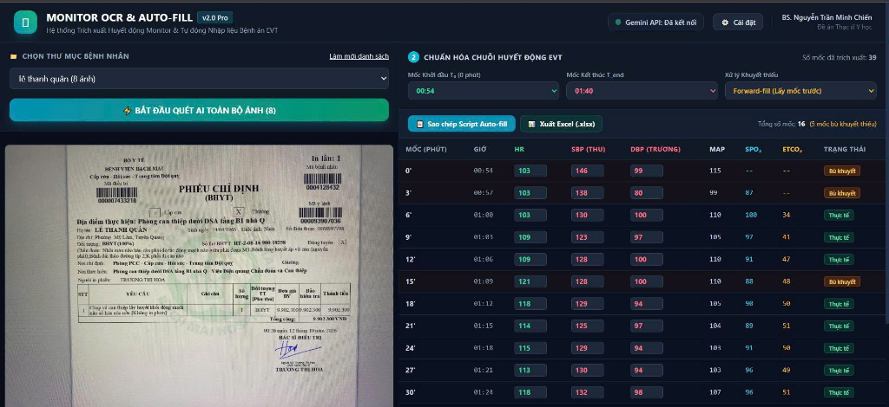
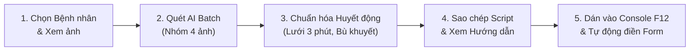
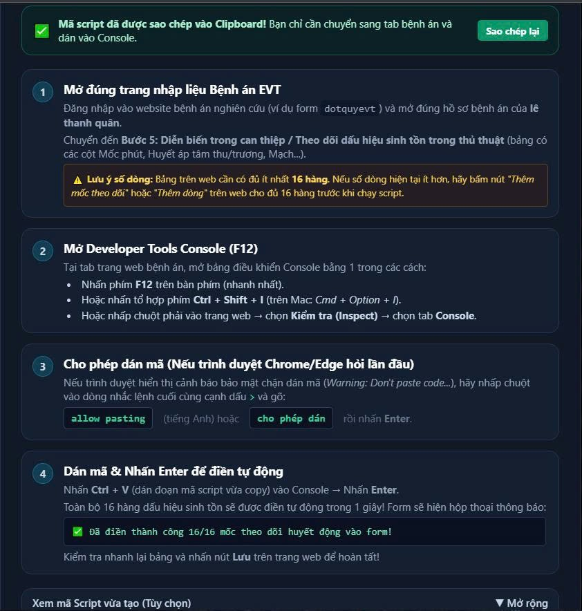

# 🫀 MONITOR OCR & AUTO-FILL v2.0 Pro
### Hệ thống Trích xuất Huyết động Monitor & Tự động Nhập liệu Bệnh án Can thiệp Mạch Não (EVT)

[](https://github.com/nguyentranminhchien-ccpl/monitor-ocr-autofill)
[](https://www.python.org/)
[](LICENSE)
[](mailto:nguyentranminhchien.hpmu@gmail.com)

> **Tác giả:** BS. Nguyễn Trần Minh Chiến  
> **Email:** [nguyentranminhchien.hpmu@gmail.com](mailto:nguyentranminhchien.hpmu@gmail.com)  
> **Chuyên ngành:** Đột quỵ não & Hồi sức Tích cực.

---

## 🌟 Giới thiệu

**Monitor OCR & Auto-fill** là bộ công cụ thông minh giải quyết khâu nhập liệu huyết động tốn nhiều thời gian và dễ nhầm lẫn trong các nghiên cứu lâm sàng can thiệp mạch não (EVT):
1. **Trích xuất bằng Thị giác AI (Gemini Vision)**: Đọc chính xác toàn bộ bảng *"Vital Signs"* (Huyết áp SBP, DBP, MAP, Nhịp tim HR, SpO2, etCO2) từ ảnh chụp màn hình monitor (Philips IntelliVue MX550/MP70, GE Carescape, Mindray...).
2. **Chuẩn hóa chuỗi thời gian 3 phút/lần**: Tự động ghép nối chuỗi ảnh theo thứ tự thời gian, tự động định dạng giờ 24h chuẩn `HH:MM`, rà soát từng phút đo ngắt quãng và xử lý dữ liệu khuyết thiếu (*Forward-fill* hoặc *Lấy trung bình*).
3. **Tự động điền biểu mẫu (Auto-fill)**: Điền toàn bộ bảng theo dõi trên web bệnh án chỉ trong 1 giây qua Console trình duyệt.


*Giao diện làm việc trực quan: Xem trước ảnh monitor bên trái và bảng số liệu chuẩn hóa lưới 3 phút bên phải.*

---

## 📥 Hướng dẫn Cài đặt & Sử dụng (Chọn 1 trong 2 cách)

---

### CÁCH 1: Dùng Bản Web App Độc lập từ GitHub Releases (Khuyên dùng - Nhanh nhất)

Dành cho bác sĩ, điều dưỡng hoặc nghiên cứu viên muốn sử dụng phần mềm nhanh chóng trên máy tính mà không cần cài đặt Antigravity:

#### Bước 1: Tải bộ cài đặt phát hành sẵn
1. Truy cập trang **Releases** trên GitHub:  
   👉 **[https://github.com/nguyentranminhchien-ccpl/monitor-ocr-autofill/releases](https://github.com/nguyentranminhchien-ccpl/Monitor-OCR-/releases)]**
2. Tải file nén mới nhất: **`monitor-ocr-autofill-v2.0-web.zip`**.
3. Giải nén vào thư mục bất kỳ trên máy tính (ví dụ: `D:\Monitor_AutoFill` trên Windows hoặc thư mục `Documents` trên Mac).

#### Bước 2: Khởi động 1-Click

##### 🖥️ Trên máy tính Windows:
1. Nhấp đúp chuột vào file: **`Chay_App_Monitor_AutoFill.bat`**.
2. Nếu máy chưa có Python, cửa sổ sẽ hiện menu hỏi bạn: chỉ cần gõ `1` và nhấn Enter để máy tự động cài đặt.
3. Trình duyệt web sẽ tự động mở trang: 👉 **`http://localhost:5000`**.

##### 🍎 Trên máy tính MacBook (macOS - Chip Apple Silicon M1/M2/M3/M4 & Intel):
1. Nhấp đúp chuột vào file: **`Chay_App_Monitor_AutoFill.command`** trong Finder.
2. Trình duyệt Safari hoặc Chrome sẽ tự động mở trang: 👉 **`http://localhost:5000`**.

> [!TIP]
> **Xử lý nhanh lần đầu mở file trên Mac:**
> - **Nếu Mac báo *"Bạn không có quyền truy cập... Hãy mở tệp - Lấy thông tin"*:* Mở **Terminal** (`Cmd + Space` gõ Terminal), gõ `chmod +x ` (nhớ có dấu cách sau `+x`), kéo file `Chay_App_Monitor_AutoFill.command` thả vào Terminal rồi nhấn **Enter**.
> - **Nếu Mac cảnh báo *"Nhà phát triển không xác định"*:* Nhấp chuột phải (hoặc chạm 2 ngón) vào file $\rightarrow$ chọn **Mở (Open)** $\rightarrow$ bấm nút **Mở (Open)**.
> - **Nếu máy chưa có Python 3:* Script sẽ tự hỏi và mở trang tải bộ cài đặt chính thức `.pkg` từ [python.org](https://www.python.org/downloads/macos/).

---

### CÁCH 2: Cài đặt qua Trợ lý Antigravity App (Dành cho người dùng Antigravity)

#### 🔹 Cách A: Cài đặt bằng 1 câu chat (Nhanh nhất)
1. Mở ứng dụng **Antigravity**.
2. Dán câu sau vào ô chat rồi nhấn **Enter**:
   > *"Cài đặt plugin từ https://github.com/nguyentranminhchien-ccpl/monitor-ocr-autofill"*  
   *(hoặc gõ lệnh: `/plugin install https://github.com/nguyentranminhchien-ccpl/monitor-ocr-autofill`)*

#### 🔹 Cách B: Cài đặt qua menu Giao diện (GUI)
1. Mở Antigravity $\rightarrow$ nhấp vào biểu tượng **Cài đặt (⚙️)** ở góc dưới bên trái $\rightarrow$ chọn **Plugins**.
2. Bấm **Add Plugin** $\rightarrow$ Dán link: `https://github.com/nguyentranminhchien-ccpl/monitor-ocr-autofill` $\rightarrow$ bấm **Install**.

#### 🎯 Thao tác trong chat:
* Kéo thả toàn bộ ảnh monitor vào ô chat $\rightarrow$ Nhắn: *"Nhận diện ảnh monitor này và tạo script auto-fill giúp tôi."*
* Antigravity sẽ đọc các mốc thời gian, hỏi bạn mốc $T_0, T_{end}$ và phương pháp bù khuyết thiếu để xuất bảng số liệu kèm mã script.

---

## ⚙️ Cấu hình Ban đầu (Chỉ tốn 1 phút)

Trên giao diện web `http://localhost:5000`, bấm vào **`⚙️ Cài đặt`** ở góc trên bên phải:

1. **Gemini API Key:** Nhập API Key miễn phí từ [Google AI Studio](https://aistudio.google.com/app/apikey).
2. **Thư mục Gốc Số liệu Bệnh nhân:** Đường dẫn thư mục lưu ảnh monitor trên máy bạn (mỗi bệnh nhân là một thư mục con chứa các file ảnh).
3. **Mô hình AI Gemini:** Mặc định sử dụng **`gemini-3.1-flash-lite`** (tốc độ nhanh nhất 1-2 giây, cực kỳ ổn định và hoàn toàn miễn phí).
4. Bấm **`Lưu Cấu hình`** (phần mềm tự lưu cho các lần sử dụng sau).

---

## 📖 Hướng dẫn Quy trình 5 Bước Thực hiện



### Bước 1: Chọn bệnh nhân & Xem ảnh
- Chọn tên bệnh nhân từ danh sách thư mục.
- Nhấp vào ảnh thumbnail để xem chi tiết ở khung preview bên trái.

### Bước 2: Bấm Quét AI toàn bộ ảnh
- Bấm nút: **`⚡ BẮT ĐẦU QUÉT AI TOÀN BỘ ẢNH`**.
- Phần mềm tự động chia nhóm 4 ảnh/lần gửi đến Gemini Vision để xử lý nhanh và tránh nghẽn mạng.

### Bước 3: Chuẩn hóa chuỗi huyết động EVT
- Chọn **Mốc khởi đầu $T_0$** (bắt đầu can thiệp) và **Mốc kết thúc $T_{end}$** (kết thúc can thiệp).
- Chọn **Xử lý khuyết thiếu**:
  - `Forward-fill (Lấy mốc trước)` *(Khuyên dùng)*: Lấy giá trị đo gần nhất phía trước điền vào.
  - `Lấy trung bình`: Tính giá trị trung bình giữa mốc trước và mốc sau.
  - `Bỏ qua (Skip)`: Để trống mốc chưa đo.
- Bảng số liệu tự động dàn đều theo chu kỳ 3 phút ($0', 3', 6', 9'...$). Bạn có thể sửa trực tiếp bất kỳ ô nào trên bảng nếu muốn.

### Bước 4: Sao chép Script Auto-fill
- Bấm nút **`📋 Sao chép Script Auto-fill`**.
- Mã script đã được copy vào Clipboard, đồng thời cửa sổ hướng dẫn 4 bước sẽ tự động bật lên màn hình.



### Bước 5: Điền tự động vào Form Bệnh án
1. Mở trang web bệnh án $\rightarrow$ mở đúng bệnh nhân $\rightarrow$ chuyển đến bảng **Theo dõi dấu hiệu sinh tồn trong thủ thuật**. Đảm bảo bảng có đủ số dòng theo dõi.
2. **Mở Console trình duyệt:**
   - **Windows (Chrome, Edge):** Nhấn phím **`F12`** (hoặc `Ctrl + Shift + I`) $\rightarrow$ chọn tab **Console**.
   - **MacBook (Chrome, Edge):** Nhấn **`Cmd + Option + I`** $\rightarrow$ chọn tab **Console**.
   - **MacBook (Safari):** Nhấn **`Cmd + Option + C`** (sau khi đã bật menu Phát triển trong Cài đặt Safari).
3. **Nếu trình duyệt chặn dán lần đầu:** Gõ `allow pasting` (hoặc `cho phép dán`) vào Console rồi nhấn **Enter**.
4. **Dán mã & Hoàn tất:**
   - Trên Windows: Nhấn **`Ctrl + V`** rồi nhấn **`Enter`**.
   - Trên Mac: Nhấn **`Cmd + V`** rồi nhấn **`Return` (Enter)**.
   - Toàn bộ bảng huyết động sẽ được điền tự động trong 1 giây. Kiểm tra lại và bấm **Lưu** trên web bệnh án.

*(Tùy chọn: Có thể bấm **`📊 Xuất Excel (.xlsx)`** để tải file Excel về máy phục vụ phân tích thống kê R, SPSS, Jamovi).*

---

## 🍎 Cẩm nang Nhanh cho Người dùng macOS (MacBook)

- **Cấp quyền file `.command` (chỉ làm 1 lần):** Mở **Terminal**, gõ `chmod +x ` (nhớ có dấu cách) $\rightarrow$ kéo file `Chay_App_Monitor_AutoFill.command` vào Terminal $\rightarrow$ nhấn **Enter**.
- **Mở khi bị Gatekeeper chặn:** Chuột phải vào file `.command` $\rightarrow$ chọn **Mở (Open)** $\rightarrow$ bấm **Mở (Open)**.
- **Sao chép đường dẫn thư mục ảnh trong Finder:** Chuột phải vào thư mục ảnh $\rightarrow$ giữ phím **Option (⌥)** $\rightarrow$ chọn **"Sao chép dưới dạng Tên đường dẫn" (Copy as Pathname)** $\rightarrow$ Dán vào ô Cài đặt.
- **Bật Console trên Safari:** Vào **Safari** $\rightarrow$ **Cài đặt (`Cmd + ,`)** $\rightarrow$ tab **Nâng cao** $\rightarrow$ Tích chọn *"Hiển thị các tính năng dành cho nhà phát triển web"*. Phím tắt mở Console là **`Cmd + Option + C`**.

### Bảng Đối chiếu Phím tắt Windows vs. macOS:
| Thao tác | Windows | macOS (MacBook) |
| :--- | :--- | :--- |
| **Mở Console F12** | `F12` hoặc `Ctrl + Shift + I` | `Cmd + Option + I` (Chrome) / `Cmd + Option + C` (Safari) |
| **Dán mã Script** | `Ctrl + V` | `Cmd + V` (Phím Command ⌘) |
| **Chạy mã** | `Enter` | `Return` (Enter) |
| **Tải lại trang web** | `F5` hoặc `Ctrl + R` | `Cmd + R` |
| **Dừng máy chủ ứng dụng** | `Ctrl + C` hoặc đóng CMD | `Ctrl + C` hoặc đóng cửa sổ Terminal |

---

## 📁 Cấu trúc Thư mục Dự án

```text
monitor-ocr-autofill/
├── Chay_App_Monitor_AutoFill.bat      # File chạy 1-click cho người dùng Windows
├── Chay_App_Monitor_AutoFill.command  # File chạy 1-click cho người dùng macOS (MacBook)
├── plugin.json                        # Khai báo manifest cho Antigravity Plugin
├── requirements.txt                   # Danh sách thư viện Python phụ thuộc
├── README.md                          # Tài liệu hướng dẫn sử dụng chi tiết
├── .gitignore                         # Loại trừ file tạm và cấu hình cá nhân
├── assets/
│   ├── logo.png                       # Biểu tượng phần mềm
│   ├── screenshot_workspace.png       # Ảnh minh họa giao diện chính
│   └── screenshot_guide_modal.png     # Ảnh minh họa cửa sổ hướng dẫn dán mã
├── rules/
│   └── AGENTS.md                      # Bộ quy tắc hành vi bắt buộc cho Antigravity Agent
├── skills/
│   └── monitor-ocr-autofill/
│       └── SKILL.md                   # Kịch bản thực thi 2 giai đoạn cho Agent
└── app/                               # Mã nguồn Ứng dụng Web
    ├── app.py                         # Máy chủ Flask Backend & Xử lý dữ liệu
    ├── start_app.py                   # Launcher khởi động Flask & tự mở trình duyệt
    ├── run.bat                        # Script chạy cục bộ Windows trong thư mục app
    ├── run_mac.command                # Script chạy cục bộ macOS trong thư mục app
    ├── requirements.txt               # Thư viện phụ thuộc backend
    ├── config.example.json            # Mẫu file cấu hình chuẩn
    ├── templates/
    │   └── index.html                 # Giao diện Frontend Single Page (Vue 3 + Tailwind CSS)
    └── static/                        # Tệp tĩnh (nếu có)
```

---

## 🛠️ Bảng Xử lý Sự cố Thường gặp

| Sự cố | Cách khắc phục |
| :--- | :--- |
| **Mac báo "Không có quyền truy cập / Hãy mở tệp - Lấy thông tin"** | Mở Terminal, gõ `chmod +x ` (nhớ có dấu cách), kéo file `.command` vào và nhấn Enter. |
| **Mac báo "Nhà phát triển không xác định"** | Nhấp chuột phải vào file `.command` $\rightarrow$ Chọn **Mở (Open)** $\rightarrow$ Bấm nút **Mở (Open)**. |
| **Không dán được mã vào Console F12** | Gõ `allow pasting` (hoặc `cho phép dán`) vào dòng nhắc lệnh Console rồi nhấn Enter trước khi dán mã. |
| **Máy tính chưa có Python** | Windows: Chọn `1` để cài tự động qua `winget`. Mac: Tải gói cài đặt `.pkg` chính thức từ [python.org](https://www.python.org/downloads/macos/). |
| **Form báo thiếu dòng khi chạy script** | Bấm *"Thêm mốc theo dõi"* hoặc *"Thêm dòng"* trên web bệnh án cho đủ số lượng dòng rồi dán lại script. |
| **Lỗi AI bận (503 / 429)** | Hệ thống tự động chia nhóm 4 ảnh/lần. Đảm bảo trong Cài đặt đang chọn model `gemini-3.1-flash-lite`. |

---

## 👨‍💻 Tác giả & Bản quyền

- **Tác giả:** BS. Nguyễn Trần Minh Chiến
- **Email:** [nguyentranminhchien.hpmu@gmail.com](mailto:nguyentranminhchien.hpmu@gmail.com)
- **Chuyên ngành:** Đột quỵ não & Hồi sức Tích cực.
- **Giấy phép:** [MIT License](LICENSE) — Hoàn toàn miễn phí phục vụ mục đích nghiên cứu y học và học tập lâm sàng.
